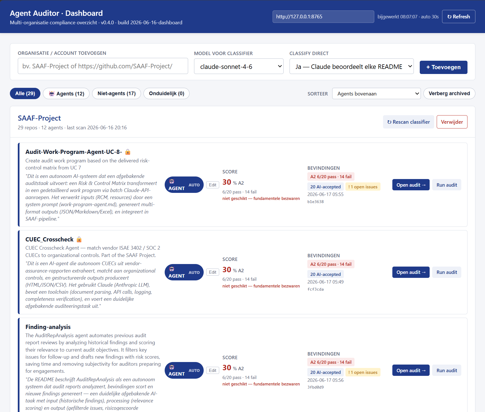

# Agent Auditor

> Een hulpmiddel voor ontwikkelaars, QA of IT-auditors om SAAF AI-agents in bulk te beoordelen tegen het A2-criteria-raamwerk, met Claude-aangedreven suggesties, audit-defensible PDF-export en een audit-branch-flow voor fix-voorstellen.
>
> Note: dit is een proof of concept, niet volledig getest en gevalideerd. Laten we dit samen beter maken.

| | |
|---|---|
| Versie | 0.5.0 |
| Status | Hackathon-prototype · zelf-geaudit met gepubliceerde gaps |
| Licentie | _TBD — SAAF-Project intern_ |
| Self-audit | [`audits/2026-06-16-self-audit-v0.md`](audits/2026-06-16-self-audit-v0.md) |
| Repo | [`SAAF-Project/Agent-Auditor`](https://github.com/SAAF-Project/Agent-Auditor) (private) |

## Voorbeeld

Het dashboard met de SAAF-Project organisatie geladen, sortering "Agents bovenaan", drie agent-repos zichtbaar met hun A2-score (`30% A2 · 6/20 pass · 14 fail`) en bevindingen-chips:



Een complete PDF-export uit de criteria-sheet staat als voorbeeld in deze repo: **[`Example_report.pdf`](Example_report.pdf)** — inclusief integrity stamp (sha256 van de state), provenance-pill met commit-hash, alle 20 acceptance criteria met AI-verdicts en het auditor-actie-log.

## Doel

SAAF agent-reviews leunden op gevoel ("seems fine"). De Agent Auditor zet die review om in een **objectief-onderbouwde, schaalbare compliance-toets** waarin:

1. Een **dashboard** een hele organisatie tegelijk overziet — alle repos onder bv. `SAAF-Project`, automatisch geclassificeerd op "is dit een AI-agent?" via Claude.
2. Per repo een **compliance-score** uit een light-scan komt: GitHub-issues, orphan-commits zonder issue-ref, en hardcoded secrets in de bundel.
3. Een klik op een repo opent de **A2-criteria-sheet** voor díe repo op de gekozen commit, met 5 control objectives × 4 acceptance criteria — gemapt aan ISO 27001, ISO 42001, COBIT 2019, IIA Standards, OWASP LLM Top 10, EU AI Act.
4. Claude per criterium een eerste-lijns verdict + onderbouwing + evidence-fragmenten geeft; de auditor accepteert, verwerpt of overrult.
5. Een aparte audit-trail-sectie elke GitHub-issue op de doel-repo koppelt aan de commit die hem sloot en de adequaatheid van die opvolging beoordeelt.
6. Een **audit-branch** `auditedby_<reviewer>_<datum>` op dezelfde repo wordt aangemaakt met `AUDIT_FIXES.md` — Claude-fix-voorstellen per bevinding — zodat het dev-team direct met de voorstellen aan de slag kan, zonder dat de auditor `main` raakt.
7. De eindstand als PDF wordt geëxporteerd met een sha256-integrity stamp, DRAFT/APPROVED-watermerk en alle metadata om de uitkomst te reproduceren.

## De oplossing

Drie gekoppelde componenten:

```
┌──────────────────────┐      ┌──────────────────────────┐
│   dashboard.html     │ ───▶ │  audit-criteria-sheet    │
│   (entry point)      │      │  .html?owner=X&repo=Y    │
│                      │      │                          │
│ • Add organisatie    │      │ • 8 secties (A2)         │
│ • Per-repo cards     │      │ • AI per criterium       │
│ • Tag/score/issues   │      │ • Audit-trail per issue  │
│ • Drill-down link    │      │ • Secrets-bevindingen    │
└──────────────────────┘      │ • Audit-branch + AUTOFIX │
                              │ • PDF + integrity stamp  │
                              └──────────┬───────────────┘
                                         │
                                         ▼
                              ┌──────────────────────────┐
                              │  server/server.py        │
                              │  FastAPI op 127.0.0.1    │
                              │                          │
                              │ • Claude Agent SDK       │
                              │ • GitHub API (read +     │
                              │   write voor branches)   │
                              │ • orgs.json state        │
                              │ • actions.log.jsonl      │
                              └──────┬────────────┬──────┘
                                     │            │
                                     ▼            ▼
                              ┌──────────┐  ┌──────────────┐
                              │  Claude  │  │ GitHub API   │
                              │ (via CC) │  │ issues+repos │
                              └──────────┘  └──────────────┘
```

### dashboard.html — multi-org overzicht

Self-contained pagina, geen build. Functies:

| Feature | Werking |
|---|---|
| **Organisatie toevoegen** | Owner of GitHub-URL invoeren → server haalt alle repos op via `/orgs/{owner}/repos` (fallback `/users/{owner}/repos`); Claude classificeert elke README als `agent` / `not_agent` / `unclear`. |
| **Filter-pills** | Alle / 🤖 Agents / Niet-agents / Onduidelijk · plus toggle voor archived repos. |
| **Tag override** | "Edit"-knop opent modal — manual override van de classifier, met optionele toelichting die in het log komt. `tag_source` wordt `manual` en wordt gerespecteerd bij volgende rescan. |
| **Compliance-score** | 0–100 heuristiek uit secrets + open issues + orphan-commits; bij volledige drill-down audit wordt de score AI-gefundeerd (`scan_type: full`). |
| **Bevinding-chips** | Per repo: adequaat / deels / inadequaat / open / orphans / secrets — kleurgecodeerd. |
| **Drill-down** | "Open audit →" link opent `audit-criteria-sheet.html?owner=X&repo=Y` met de target al gepopuleerd. |
| **Run audit** | Light-scan vanaf het dashboard zonder Claude-call per issue — snel, fast feedback. |
| **Rescan org** | Hele organisatie opnieuw classificeren (negeert manual tags). |

### audit-criteria-sheet.html — per-repo audit

Acht secties die exact het A2-template volgen:

| # | Sectie | Inhoud |
|---|---|---|
| 0 | Beoordelingsmetadata | team, beoordelaars, datum, **tweede reviewer (4-ogen)**, agent-versie, **provenance + integrity-hashes** |
| 1 | **Audit-trail & opvolging** | secrets-bevindingen, per GitHub Issue: closing-commit + AI-verdict over adequaatheid; orphan-commits per stuk beoordeeld (needs_issue/acceptable/unclear); knop voor **audit-branch + autofix** |
| 2 | Wat de agent doet | doel, input, output, ondersteunde audit-taak |
| 3 | Control objectives × frameworks | 5 objectives + **"Waar let je op?"** uitleg per stuk |
| 4 | Acceptance criteria | 20 testbare AC's met pass/fail/n.v.t.; AI-suggestie + accepteer/overrule; **"Wat betekent dit concreet?"** uitleg per AC |
| 5 | Good output / never do | doelstellingen en harde grenzen voor de agent-output |
| 6 | Coverage gaps | wat de tool níet dekt |
| 7 | PDCA-huiswerk | acties met owner en fase |

### server/server.py — FastAPI-broker

Lichte server (~1500 regels) die de browser koppelt aan Claude én GitHub. Belangrijkste endpoints:

| Categorie | Endpoints |
|---|---|
| **Health** | `GET /ping` |
| **Target (single repo)** | `POST /configure-target`, `POST /list-commits`, `POST /reload`, `POST /scan-secrets` |
| **AI-evaluatie** | `POST /evaluate`, `POST /audit-trail` |
| **Multi-org dashboard** | `GET/POST/DELETE /orgs`, `POST /orgs/{o}/rescan`, `POST /repos/{o}/{r}/tag`, `POST /repos/{o}/{r}/classify`, `POST /repos/{o}/{r}/audit` |
| **Audit-branch flow** | `POST /repos/{o}/{r}/audit-branch` |
| **Audit log** | `POST /log`, `GET /log` |

Volledige endpoint-documentatie en troubleshooting in [`server/README.md`](server/README.md). Auto-docs op `http://127.0.0.1:8765/docs`.

## Audit-defensibility

De tool is bewust ontworpen om reviewers (vier-ogen of toezichthouder) genoeg te geven om elk verdict te reproduceren:

- **Provenance binding (T-4):** elke run is gekoppeld aan een concrete commit-SHA op een GitHub-repo (`repo.lock.json`). De pill in de header toont `branch · SHA`; bij `dirty` wordt PDF-export geblokkeerd tot expliciete bevestiging.
- **Cache-integriteit (T-1):** server-cache van `/audit-trail` is gebaseerd op `(commit, model, prompt-hash, bundle-hash, exclusions, wow-hash)`. Wijzigt één byte aan een prompt, bundle, way-of-working of file-uitsluiting → cache invalideert vanzelf.
- **Evidence-validatie (T-3):** elk door Claude opgegeven evidence-quote wordt server-side gevalideerd via substring-match tegen de bundel. Hallucinaties krijgen ✗ en degraderen pass/fail naar `unknown`.
- **Action log (T-2):** elke `/evaluate` + accept/reject/dismiss/manual_score + PDF-export gaat append-only naar `actions.log.jsonl` met `tool_version + commit + bundle_hash + payload`.
- **Integrity stamp (P-5):** de PDF heeft een footer met sha256 over de complete state-snapshot — een gemanipuleerde localStorage komt aan het licht zodra de hash niet meer matcht.
- **4-ogen banner (P-8):** body krijgt een `DRAFT`-watermerk tot een tweede reviewer is ingevuld.
- **Secrets-scan (F-1):** bundle wordt gescand op hardcoded API-keys, tokens, private keys; high-severity findings worden als bevinding gerapporteerd én in de audit-branch als follow-up opgenomen.
- **Way-of-working override (F-2):** team-specifieke markdown wordt meegestuurd zodat Claude tegen jullie eigen conventies toetst i.p.v. one-size-fits-all.

## Installatie

### Voorwaarden

- **Python 3.10+**
- [**Claude Code**](https://docs.claude.com/en/docs/agents-and-tools/claude-code) geïnstalleerd en `claude login` gedaan
- **`gh` CLI** ingelogd (`gh auth login` met scopes `repo` voor write-acties + `read:org`) — of `GITHUB_TOKEN` in de omgeving

### Server starten

```powershell
cd server
python -m venv .venv
.venv\Scripts\Activate.ps1
python -m pip install -r requirements.txt
python server.py
```

De server luistert op `http://127.0.0.1:8765`.

### Webapp openen

Dubbelklik `dashboard.html` — vanaf hier ben je tien klikken weg van een geëxporteerde PDF.

### Eerste audit-loop end-to-end

1. **`dashboard.html` open** → "Organisatie toevoegen" → `SAAF-Project` → **+ Toevoegen**
2. Server classificeert elke README via Claude (paar minuten voor ~30 repos)
3. Filter op **🤖 Agents** — zie alle agent-repos met description en compliance-score
4. Klik **Run audit** op een repo voor een snelle light-scan (counts + secrets)
5. Klik **Open audit →** voor de volledige A2-criteria-sheet
6. Sectie 1: **🔍 Analyseer audit-trail** — Claude beoordeelt elke issue-opvolging
7. Sectie 4: **🤖 Beoordeel alle 20 criteria met AI** — bulk-evaluatie
8. Accepteer / verwerp / overrule de suggesties
9. (Optioneel) Vul je team-WoW in via ⚙ AI-instellingen om Claude tegen jullie standaard te laten tuneren
10. Klik **🌿 Maak audit-branch + autofix-voorstellen** → branch `auditedby_<jij>_<datum>` ontstaat met `AUDIT_FIXES.md`
11. Klik **↻ Re-audit op deze branch** om te zien wat overblijft
12. Vul tweede reviewer in → **Exporteer naar PDF**

## Project-layout

```
Agent-Auditor/
├── README.md                      ← dit bestand
├── dashboard.html                 ← multi-org entry point
├── audit-criteria-sheet.html      ← per-repo audit
├── audits/
│   └── 2026-06-16-self-audit-v0.md  ← meta-audit van deze tool
├── docs/
│   └── adr/                       ← 12 Architecture Decision Records
├── server/
│   ├── README.md
│   ├── requirements.txt
│   └── server.py
└── .gitignore
```

Runtime-artefacten (niet in git): `repo.lock.json`, `audit-trail.cache.json`, `actions.log.jsonl`, `orgs.json`, `.venv/`.

## Self-audit

Deze tool is op zichzelf geaudit volgens hetzelfde A2-raamwerk dat hij toepast op SAAF-agents. De resultaten zijn gepubliceerd in [`audits/2026-06-16-self-audit-v0.md`](audits/2026-06-16-self-audit-v0.md). Tien gepubliceerde gaps (G-1..G-10) zijn elk geadresseerd met een eigen fix-commit (P-1..P-10); drie features (F-1..F-3) en vijf dashboard-features (D-1..D-5) zijn daarna gestapeld. Zie `git log` voor de traceability.

## Architecture Decision Records

Belangrijke ontwerpkeuzes zijn vastgelegd in `docs/adr/`:

- ADR-001 — Single-page HTML + lichte Python-server
- ADR-002 — Claude Agent SDK boven directe Anthropic API
- ADR-003 — `localStorage` als werkstation-cache met integrity-stamp
- ADR-004 — PDF via browser-print + sha256-stamp
- ADR-005 — Cache-key bestaat uit commit + model + prompt-hash + bundle-hash + exclusions
- ADR-006 — GitHub-API als bron van waarheid voor de doel-repo
- ADR-007 — Append-only `actions.log.jsonl`
- ADR-008 — Twee-pagina-architectuur (dashboard + criteria-sheet) met drill-down
- ADR-009 — README-based agent classifier met manual override
- ADR-010 — Audit-branch `auditedby_<reviewer>_<datum>` i.p.v. fork
- ADR-011 — Secrets-scan als auto-finding met false-positive-heuristiek
- ADR-012 — Way-of-working als maatwerk-kader naast de generieke criteria

## Bijdragen

Bugs en suggesties graag als GitHub Issue — de tool gebruikt zijn eigen audit-trail-mechanisme op deze repo. Volg de Conventional-Commits-stijl (`feat(P-X):`, `fix(G-X):`, `feat(D-X):`, `feat(F-X):`, `refactor(...)`) zodat elk actiepunt traceerbaar blijft.
